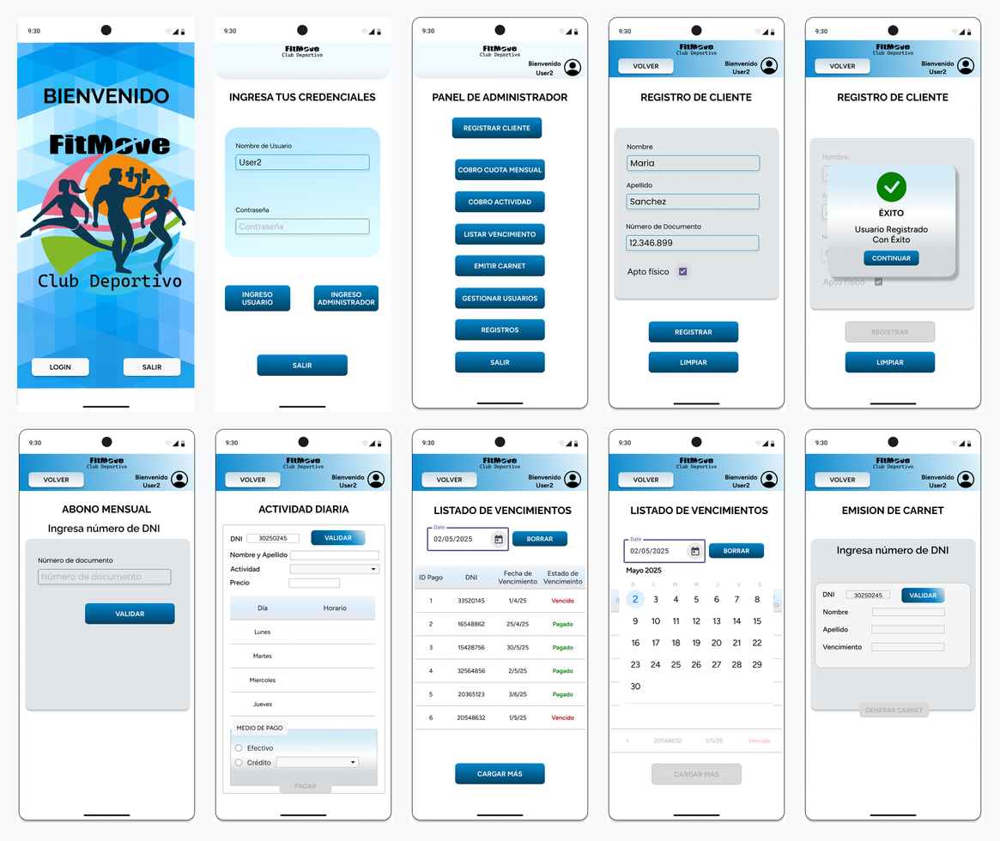

# FitMove · App para un club deportivo

App Android para la administración de un club deportivo: registro de clientes, cobro de cuotas mensuales y actividades diarias, listado de vencimientos y emisión del carnet de socio.

Proyecto grupal de la materia Dispositivos Móviles de la Tecnicatura Superior en Desarrollo de Software (IFTS N.º 29), 2025. Este repositorio es una copia del original con todo su historial de commits.

**Mi parte:** diseño de la interfaz en Figma y desarrollo de pantallas de la app.

**[Ver el diseño en Figma](https://www.figma.com/design/GscWpGdKJxc971sj3LGUzW/Dispositivos-M%C3%B3viles)**

## Funciones

- Ingreso con usuario y contraseña, con perfiles de usuario y de administrador
- Registro de clientes con control de apto físico
- Cobro de cuota mensual y de actividades diarias, en efectivo o con tarjeta en cuotas
- Listado de vencimientos filtrado por fecha
- Emisión del carnet de socio

## Stack

- **Kotlin** con Activities y layouts XML
- **SQLite** con `SQLiteOpenHelper` (tablas de usuarios, clientes, socios, actividades y pagos)
- Android SDK 35, compatible desde Android 7.0 (API 24)

## Correrlo

Abrir el proyecto en Android Studio, sincronizar Gradle y ejecutar en un emulador o dispositivo con Android 7.0 o superior.
